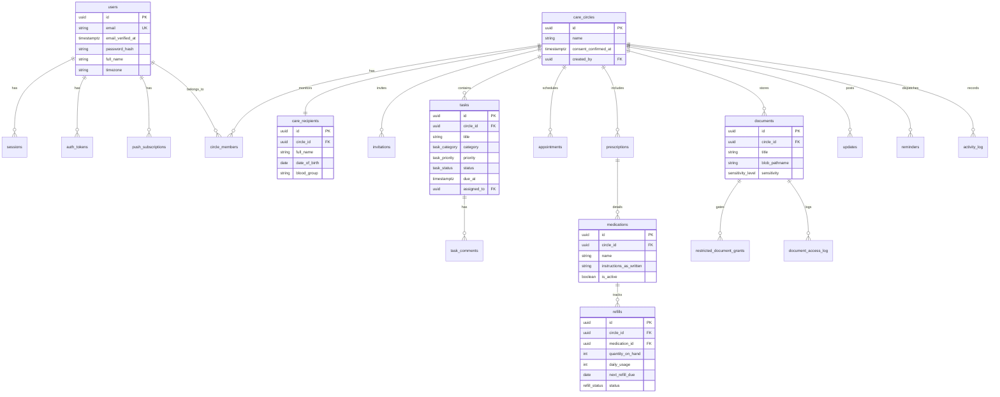

# Family Care Hub: Data Model & SQL Contracts

## 1. Entity-Relationship Diagram (Mermaid)

---

## 2. Role-Based Permissions Matrix

| Capability | Owner | Coordinator | Caregiver | Viewer | Care Recipient |
|---|---|---|---|---|---|
| Manage members and roles | ✅ | Invite only | ❌ | ❌ | ❌ |
| View dashboard and timeline | ✅ | ✅ | ✅ | ✅ | ✅ (simplified) |
| Create/edit appointments, meds, refills | ✅ | ✅ | ✅ | ❌ | ❌ |
| Create and assign tasks | ✅ | ✅ | Self only | ❌ | ❌ |
| Complete / claim tasks | ✅ | ✅ | ✅ | ❌ | ❌ |
| View normal documents | ✅ | ✅ | ✅ | ✅ | ✅ |
| View restricted documents | ✅ | ✅ | If granted | ❌ | If granted |
| Delete records | ✅ | ✅ (soft) | Own uploads | ❌ | ❌ |
| View activity log | ✅ | ✅ | ✅ | ✅ | ❌ |
| Export / delete circle | ✅ | ❌ | ❌ | ❌ | ❌ |

---

## 3. SQL Functions & Contracts

| Function | Security Mode | Arguments | Return Type | Description |
|---|---|---|---|---|
| `circle_dashboard(p_circle)` | `SECURITY INVOKER` | `p_circle: uuid` | `jsonb` | 10-second high-level circle status board data |
| `who_did_what(p_circle, p_from, p_to)` | `SECURITY INVOKER` | `p_circle: uuid, p_from: timestamptz, p_to: timestamptz` | `table(...)` | Per-member task completion and accountability metrics |
| `circle_timeline(p_circle, p_cursor, p_kinds, p_limit)` | `SECURITY INVOKER` | `p_circle: uuid, p_cursor: timestamptz, p_kinds: text[], p_limit: int` | `table(...)` | Cursor-based unified timeline of events and records |
| `claim_task(p_task)` | `SECURITY INVOKER` | `p_task: uuid` | `void` | Assigns an unassigned task to `app_uid()` |
| `complete_task(p_task)` | `SECURITY INVOKER` | `p_task: uuid` | `void` | Marks task completed by `app_uid()` |
| `create_invitation(p_circle, p_email, p_role)` | `SECURITY INVOKER` | `p_circle: uuid, p_email: text, p_role: circle_role` | `text` | Returns single-use token; stores SHA-256 hash (72h expiry) |
| `accept_invitation(p_token)` | `SECURITY DEFINER` | `p_token: text` | `uuid` | Validates token, email verification, joins circle |
| `enqueue_reminder(...)` | `SECURITY INVOKER` | `circle, target, kind, channel, entity, remind_at, payload` | `void` | Idempotent reminder enqueue |

---

## 4. Migration Rules

1. **Never edit a merged migration file.**
2. If your branch's generated migration conflicts with one merged on `main` (number or `meta/_journal.json`):
   - Delete your generated migration and snapshot in `db/migrations/meta/`.
   - Rebase your branch on `main`.
   - Run `npm run db:generate` again.
3. Custom SQL migrations (`0001_extensions_and_roles.sql`, `0002_rls_helpers_and_policies.sql`, `0003_audit_triggers.sql`, `0004_sql_contracts.sql`) are **never regenerated**, only renumbered if needed.
