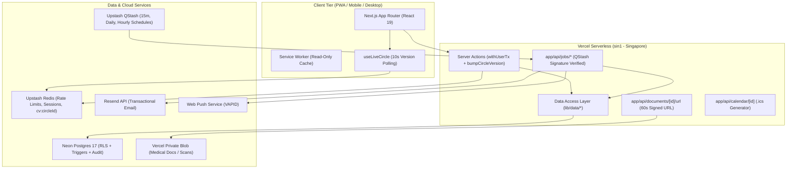
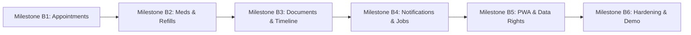

# Family Care Hub — Member B Master Implementation Plan
**Domain:** Records, Medicines, Documents, Automation, Platform & Hardening  
**Target Spec:** `CLAUDE.md` (v2: Neon + Upstash + Vercel) & `05_MEMBER_B_records_and_automation.md`  
**Teammate:** Member A (Onboarding, Roles, Tasks, Updates, Activity, Status Board)  
**Strict Rule:** No code changes made in this planning phase.

---

## 1. Executive Summary & Project Architecture

### 1.1 Problem Statement & Persona
- **Context:** CodeBenders ACE Builders' Hackathon 2026, Problem Statement 4 (*Health and Family Care*).
- **Core User Need:** Adult siblings (often living in different cities or abroad, e.g., Bengaluru, Pune, Dubai) coordinating elder care for a parent (e.g., Kamala Sharma, 74).
- **North-Star Test:** A sibling 2,000 km away can open the hub and understand the entire care state in **10 seconds** — what is overdue, what is next, and who owns it.

### 1.2 Non-Negotiable Medical & Security Guardrails
1. **Verbatim Medical Instructions:** Medicine instructions are stored and shown strictly verbatim as written on prescriptions (`instructions_as_written`). The platform **never** calculates dosages, never diagnoses, never flags test results as "normal/abnormal", and never offers medical advice. Refill math uses only user-provided numbers (quantity on hand / daily usage).
2. **Persistent Disclaimer:** The persistent footer: *"Family Care Hub organises information only and does not provide medical advice. Always consult a doctor."* is present across all layouts.
3. **Zero Medical Leakage in Notifications:** Push notifications, emails, and SMS/webhooks must **never** contain medicine names, diagnoses, or document titles in transit. Notifications provide neutral prompts (e.g. *"You have a care reminder from Family Care Hub"*), with full details visible only after secure login.
4. **Data Isolation & DPDP Compliance:** All operations are isolated by `circle_id`. Document access is strictly gated by Postgres RLS (`can_view_document`). Private file storage in Vercel Blob dispenses short-lived (60s) signed URLs. Right to erasure and data export are guaranteed.

### 1.3 Tech Stack & Architecture Alignment (v2 Clarification)
> [!IMPORTANT]
> While `05_MEMBER_B_records_and_automation.md` originally referenced Supabase Edge Functions and `pg_cron`, the repository was migrated in Setup 1–3 to the **v2 Architecture** (`CLAUDE.md` and `docs/DECISIONS.md`):
> - **Database:** Neon Serverless Postgres 17 (`aws-ap-southeast-1` Singapore) with Drizzle ORM.
> - **Storage:** Vercel Private Blob (`@vercel/blob` >= 2.3) with 60s signed download tokens.
> - **Automation:** Upstash QStash invoking signed Vercel route handlers in `app/api/jobs/*` (with HMAC signature verification).
> - **Notifications:** Resend for transactional email + `web-push` (VAPID) for browser push notifications.
> - **Reactivity:** Upstash Redis version counter `cv:{circleId}` polled every 10s by `useLiveCircle`.



---

## 2. File Ownership & Collaboration Boundaries

Per `docs/COLLABORATION.md`, strict file ownership applies. Member B **must not edit Member A's files**, and must use the shared frozen contracts as-is.

### 2.1 Files Owned by Member B
| Category | File Paths |
|---|---|
| **UI Components** | `components/features/appointments/**`<br>`components/features/timeline/**`<br>`components/features/documents/**`<br>`components/features/meds/**`<br>`components/features/notifications/**`<br>`components/features/care-mode/**`<br>`components/features/pwa/**`<br>`components/features/settings-data/**` |
| **Data Access Layer** | `lib/data/appointments.ts`<br>`lib/data/documents.ts`<br>`lib/data/medications.ts`<br>`lib/data/refills.ts`<br>`lib/data/timeline.ts`<br>`lib/data/export.ts` |
| **Zod Schemas** | `lib/schemas/appointments.ts`<br>`lib/schemas/documents.ts`<br>`lib/schemas/medications.ts`<br>`lib/schemas/refills.ts`<br>`lib/schemas/notifications.ts` |
| **Database Schema** | `db/schema/appointments.ts`<br>`db/schema/medications.ts`<br>`db/schema/documents.ts`<br>`db/schema/notifications.ts` |
| **Storage & Jobs** | `lib/jobs/**`<br>`lib/utils/blob.ts`<br>`app/api/jobs/**` (`send-reminders`, `refill-checker`, `daily-digest`, `escalation`) |
| **Application Routes** | `app/(app)/c/[circleId]/appointments/**`<br>`app/(app)/c/[circleId]/meds/**`<br>`app/(app)/c/[circleId]/documents/**`<br>`app/(app)/c/[circleId]/timeline/**`<br>`app/(app)/c/[circleId]/care-mode/**`<br>`app/(app)/c/[circleId]/settings/notifications/**`<br>`app/(app)/c/[circleId]/settings/data/**`<br>`app/api/calendar/[appointmentId]/route.ts`<br>`app/api/documents/[documentId]/url/route.ts` |
| **PWA & Platform** | `app/manifest.ts`<br>`public/sw.js` |
| **Documentation & Tests** | `docs/DEMO.md`<br>`tests/unit/b-*.test.ts`<br>`tests/e2e/b-*.spec.ts` |

### 2.2 Frozen Contracts Consumed by Member B
- `requireCircleRole(circleId, allowed?)`: Validates verified user, executes in transaction, sets context (`role`, `circleName`, `recipientName`).
- `withUserTx(userId, fn)`: Wraps queries with `SET LOCAL app.user_id = $userId` so Postgres RLS is enforced.
- `createTaskCore(ctx, input)`: Creates linked tasks for appointments and refills (owned by Member A, called by Member B).
- `enqueueNotification(ctx, input)`: Inserts idempotent reminders via `enqueue_reminder(...)` SQL function.
- `bumpCircleVersion(circleId)`: Must be invoked after every mutation in Member B's server actions.
- `can_view_document(documentId)`: SQL security definer function evaluating role and `restricted_document_grants`.
- `circle_timeline(p_circle, p_cursor, p_kinds, p_limit)`: SQL contract returning unified timeline items with privacy masking.

---

## 3. Milestone-by-Milestone Implementation Plan



---

### Milestone B1: Appointments (`b/appointments`)
> **Goal:** Complete doctor appointment lifecycle, automated coordination tasks, reminders, and iCalendar feed.

#### 1. Data Access & Schemas
- Review `lib/schemas/appointments.ts`: ensure `createAppointmentSchema` and `updateAppointmentSchema` support:
  - `title`, `doctorName`, `specialty`, `location`, `startsAt`, `endsAt`, `accompaniedBy`, `notes`, `sensitivity`.
  - Checkboxes input: `createDocTask?: boolean`, `createAccompanyTask?: boolean`.
- Implement `lib/data/appointments.ts`:
  - `getAppointments(circleId: string, type: 'upcoming' | 'past')`: ordered by `startsAt` ASC (upcoming) or DESC (past). Joined with `users` for companion avatar.
  - `getAppointmentById(circleId: string, appointmentId: string)`.
  - `createAppointment(ctx: CircleContext, input: CreateAppointmentInput)`.
  - `updateAppointment(ctx: CircleContext, id: string, input: UpdateAppointmentInput)`.
  - `resolveAppointment(ctx: CircleContext, id: string, outcome: 'completed' | 'missed' | 'rescheduled', notes?: string)`.

#### 2. Mutation Logic & Contract Integration
- In `createAppointment`:
  1. Insert into `appointments` using `withUserTx`.
  2. If `createDocTask` is true: call `createTaskCore(ctx, { title: 'Prepare documents for ' + doctorName, category: 'appointment', priority: 'normal', dueAt: startsAt - 24h, linkedEntityType: 'appointment', linkedEntityId: appointment.id, assignedTo: ctx.userId })`.
  3. If `createAccompanyTask` is true and `accompaniedBy`: call `createTaskCore(ctx, { title: 'Accompany to appointment: ' + title, category: 'appointment', priority: 'high', dueAt: startsAt, linkedEntityType: 'appointment', linkedEntityId: appointment.id, assignedTo: accompaniedBy })`.
  4. Enqueue reminders 24h and 2h before `startsAt` via `enqueueNotification`:
     - Target: Accompanied person and circle coordinator.
     - Kind: `'appointment'`, Channel: `'push'` and `'email'`.
     - Payload: neutral notification text (e.g., *"Doctor appointment scheduled in 2 hours"*).
  5. Call `bumpCircleVersion(ctx.circleId)`.

#### 3. UI Components
- `components/features/appointments/quick-add-appointment.tsx`:
  - Modern dialog with Date/Time picker, Doctor Name, Specialty, Location, Companion picker (`circle_members`), and the 2 auto-task checkboxes (default checked).
- `app/(app)/c/[circleId]/appointments/page.tsx`:
  - Tabs: **Upcoming** and **Past**.
  - Appointment cards: Doctor name, specialty badge, formatted time in user timezone, Google Maps link (`https://maps.google.com/?q={encodeURIComponent(location)}`), companion avatar with tooltip, status pill.
  - Post-appointment resolution banner: If `endsAt < now()` and `status === 'scheduled'`, show **"How did it go?"** with one-click actions:
    - **Completed**: opens brief note dialog + option to "Attach medical report" (prefills document upload with appointment metadata).
    - **Missed**: records status and prompts to reschedule.
    - **Rescheduled**: opens edit sheet with date picker.

#### 4. Calendar Feed Route
- `app/api/calendar/[appointmentId]/route.ts`:
  - Session validation using `requireUser()`.
  - Verify circle membership via `withUserTx`.
  - Generate standards-compliant `.ics` file (RFC 5545):
    - `SUMMARY`: Neutral title (e.g., `Doctor appointment – ${recipientName}`).
    - `DTSTART`, `DTEND`, `LOCATION`, `DESCRIPTION`.
  - Return with headers: `Content-Type: text/calendar; charset=utf-8`, `Content-Disposition: attachment; filename="appointment.ics"`.

---

### Milestone B2: Medicines and Refill Tracker (`b/meds`)
> **Goal:** Active/past medicine catalog with verbatim prescription instructions, automated refill countdowns, and one-tap refill workflow.

#### 1. Data Access & Schemas
- Review `lib/schemas/medications.ts` & `lib/schemas/refills.ts`.
- Implement `lib/data/medications.ts` & `lib/data/refills.ts`:
  - `getActiveMedications(circleId)`: join `medications` with `refills`, calculate days left, sorted by urgency (`next_refill_due` ASC).
  - `getPastMedications(circleId)`: `isActive = false` or `endDate < today`.
  - `createMedicationWithRefill(ctx: CircleContext, input: CreateMedicationInput)`: creates medication and associated refill tracking row.
  - `markRefillOrdered(ctx: CircleContext, refillId: string)`.
  - `markRefillCompleted(ctx: CircleContext, refillId: string, newQuantity: number)`.

#### 2. Strict Guardrail Implementation
- Medication card rendering:
  - Instructions MUST be wrapped in a dedicated component:
    ```tsx
    <div className="rounded-md border-l-4 border-amber-500 bg-amber-500/10 p-3">
      <span className="text-xs font-semibold uppercase tracking-wider text-amber-700 dark:text-amber-400">
        As written on prescription
      </span>
      <p className="mt-1 font-mono text-sm">{medication.instructionsAsWritten}</p>
    </div>
    ```
  - Under no circumstances compute dosage, alter text, or provide drug interaction advice.
  - Disclaimer banner rendered below the header: *"Family Care Hub organises information only and does not provide medical advice. Always consult a doctor."*

#### 3. Refill Tracking & Workflow
- **Refill Countdown Logic:**
  - `daysLeft = floor(quantityOnHand / dailyUsage)`.
  - Visual status:
    - Normal (`ok`): Green badge, days left > 5.
    - Due soon (`due_soon`): Amber badge, 0 < days left <= 5.
    - Overdue (`overdue`): Red flashing badge, days left <= 0.
    - Ordered (`ordered`): Blue badge ("Refill ordered on [date]").
  - Progress bar showing estimated supply depleted vs remaining.
- **Refill Action Workflow:**
  - Button 1: **"Mark Ordered"** → updates status to `'ordered'`, logs activity.
  - Button 2: **"Mark Refilled"** → Dialog asks: *"How many units received?"* (e.g. 30 tablets). Updates `quantity_on_hand = newQuantity`, `last_refilled_on = today`.
  - Database trigger `trg_compute_refill_status` automatically recalculates `next_refill_due` and resets status to `'ok'`.
  - Call `bumpCircleVersion(ctx.circleId)`.

---

### Milestone B3: Documents and the Timeline (`b/documents-timeline`)
> **Goal:** Secure camera capture & upload to Vercel Private Blob, magic bytes verification, EXIF stripping, 60s signed access, restricted document gating, and unified cursor-paginated timeline.

#### 1. Blob Storage & Security Pipeline (`lib/utils/blob.ts`)
- Implement file validation:
  - Check file size (`<= 10MB`).
  - Read first 4100 bytes and detect actual MIME type with `file-type` (reject renamed `.exe` files disguised as `.pdf`).
  - Compute SHA-256 hash using Web Crypto API.
  - Strip EXIF metadata from images using `sharp` to protect location privacy.
- Private Blob upload:
  - Upload via `@vercel/blob` with `access: 'private'` and path: `circle/{circleId}/{documentId}/{filename}`.
  - Rollback safety: If DB insert fails, purge the uploaded blob. If upload fails, remove the DB row. No orphan assets.

#### 2. Viewing & Restricted Document Gating
- Implement `app/api/documents/[documentId]/url/route.ts` & DAL `getDocumentDownloadUrl`:
  - Verify user session and circle membership.
  - Query Postgres function `SELECT can_view_document($documentId)`. If false, return 403 Forbidden.
  - Dispense a 60-second signed URL via `getDownloadUrl` from `@vercel/blob`.
  - Log access synchronously to `document_access_log` (`userId, documentId, circleId, action: 'viewed'`).
- Restricted Grants UI:
  - Owner and Coordinator can open a "Document Access & Sharing" dialog.
  - Select circle members to grant access (`restricted_document_grants`).
  - "Viewed by" audit list showing who viewed the document and when.

#### 3. Unified Timeline (`/c/[circleId]/timeline`)
- Data Access (`lib/data/timeline.ts`):
  - Call SQL contract `circle_timeline(p_circle, p_cursor, p_kinds, p_limit)`.
  - Cursor pagination based on `occurred_at`.
- Client UI:
  - Infinite scroll using TanStack Query `useInfiniteQuery`.
  - Grouped by month with sticky headers (`November 2026`, `October 2026`).
  - Filter chips: All, Appointments, Prescriptions, Reports, Updates.
  - Item Cards: Icon by kind (Calendar, Pill, FileText, MessageSquare), Title, Subtitle, Actor avatar, Relative time (`formatRelative`).
  - Restricted items: For users without access, the SQL contract returns `"Restricted document"` with a lock badge.
  - Click interaction: Opens the respective view sheet or document preview modal.

---

### Milestone B4: Reminder and Notification Pipeline (`b/notifications`)
> **Goal:** Production-grade background automation using Upstash QStash, Resend, and Web Push with idempotency and zero medical data leakage.

#### 1. Background Jobs (`app/api/jobs/*`)
All job routes verify the QStash signature using `@upstash/qstash` `Receiver`:
```ts
const receiver = new Receiver({
  currentSigningKey: serverEnv.QSTASH_CURRENT_SIGNING_KEY,
  nextSigningKey: serverEnv.QSTASH_NEXT_SIGNING_KEY,
});
```

1. **`POST /api/jobs/send-reminders` (Every 15 min):**
   - Connect via `db/admin.ts`.
   - Batch query with row lock:
     ```sql
     SELECT * FROM reminders
     WHERE sent_at IS NULL AND remind_at <= now()
     ORDER BY remind_at LIMIT 500
     FOR UPDATE SKIP LOCKED;
     ```
   - Process by channel:
     - **Email:** Send via Resend with accessible template (circle name, neutral title, link to Hub, unsubscribe link).
     - **Push:** Send via `web-push` to `push_subscriptions` for `target_user_id`. Remove stale subscriptions on 404/410.
   - Update: On success, set `sent_at = now()`. On failure, increment `attempt_count`, record `last_error`. If `attempt_count >= 5`, abandon.
2. **`POST /api/jobs/refill-checker` (Daily 07:00 IST / 01:30 UTC):**
   - Identify refills where `next_refill_due <= today + 5 days` or `status IN ('due_soon', 'overdue')`.
   - Ensure an open task exists: if none, invoke `createTaskCore` (`category = 'medication'`, `linkedEntityType = 'refill'`).
   - If `status = 'overdue'`, enqueue reminders to all circle caregivers.
3. **`POST /api/jobs/daily-digest` (Daily 20:00 IST):**
   - Aggregate pending and overdue items per user across all their circles.
   - Send single consolidated email: count of tasks due tomorrow, count of overdue items, "Open Family Care Hub" button. **Zero medical details**.
4. **`POST /api/jobs/escalation` (Hourly):**
   - Find tasks where `due_at < now() - interval '24 hours'` and `status != 'done'`.
   - Enqueue high-priority reminder to circle coordinator (idempotent, once per task).

#### 2. User Notification Preferences & Web Push
- Route: `/c/[circleId]/settings/notifications`.
- UI toggles: Email notifications (on/off), Web Push (on/off), Daily digest (on/off + preferred time), Quiet hours (e.g., 22:00 to 07:00).
- Web Push client helper: Service worker push manager subscription, saving public keys (`p256dh`, `auth`) to `push_subscriptions`.

---

### Milestone B5: PWA, Care-Recipient Mode and Data Rights (`b/platform`)
> **Goal:** Installable offline PWA, simplified high-contrast view for elderly care recipients, and DPDP-compliant data export/erasure.

#### 1. Progressive Web App (PWA)
- `app/manifest.ts`:
  - `name: "Family Care Hub"`, `short_name: "CareHub"`, `display: "standalone"`, `theme_color`, `background_color`, high-res icons.
- `public/sw.js`:
  - Cache app shell, CSS/JS bundles, and cache the last visited dashboard and today's tasks for **read-only offline viewing**.
  - Intercept fetch requests: if offline, return cached response with header `x-fch-offline: true`.
- UI Offline Banner:
  - Show a non-intrusive warning: *"Offline: showing last saved information."*
  - Install prompt toast on Android/iOS Safari.

#### 2. Care-Recipient Mode (`/c/[circleId]/care-mode`)
- Accessible, calm, ultra-simplified interface:
  - Font size >= 20px, high-contrast palette (WCAG AAA).
  - Exactly two big cards:
    1. **"Today's Medicines"**: Large font medication name, strength, and the verbatim instructions.
    2. **"Next Doctor Visit"**: Date, doctor name, and companion avatar with "Coming with you".
  - Large sticky button: **"Call Family"** with `tel:<emergency_contact_phone>`.
- Auto-redirect: If a logged-in user has the `care_recipient` role, the circle layout automatically routes them to `/c/[circleId]/care-mode`.

#### 3. Data Rights & Export (Owner Only)
- Route: `/c/[circleId]/settings/data`.
- **Export Circle Data:**
  - Streams a ZIP file containing:
    - `circle_overview.json` (metadata, care recipient info, members).
    - `appointments.json`, `medications.json`, `refills.json`, `tasks.json`, `timeline.json`.
    - `documents/` folder containing all uploaded PDFs/images streamed directly from Vercel Private Blob.
- **Permanent Circle Deletion:**
  - Destructive action: user must re-type the exact circle name to confirm.
  - Server Action:
    1. Purge all Blob storage objects under `circle/{circleId}/`.
    2. Delete the `care_circles` record (Postgres cascade deletes all associated relational rows).
    3. Clear all related Redis keys and version counters.
    4. Log the deletion event.

---

### Milestone B6: Tests, Hardening & Final Demo (`b/tests`)
> **Goal:** Comprehensive unit and E2E coverage, security verification, and hackathon presentation readiness.

#### 1. Unit Tests (`tests/unit/b-*.test.ts`)
- `refill-math.test.ts`: Test supply countdown, status transitions (`ok` -> `due_soon` -> `overdue`), and trigger computation.
- `ics-calendar.test.ts`: Validate RFC 5545 `.ics` formatting, timezone offsets, and neutral title generation.
- `magic-bytes.test.ts`: Test file inspection with real PNG/PDF headers and detect malicious renamed executables.
- `reminder-idempotency.test.ts`: Assert that processing the same reminder batch twice never dispatches duplicate emails or pushes.
- `notification-sanitization.test.ts`: Verify that generated notification subjects/bodies contain zero medicine names, diagnoses, or document titles.

#### 2. Playwright E2E Tests (`tests/e2e/b-*.spec.ts`)
1. **Document Upload & Viewer Access:** Caregiver uploads a sample PDF -> Viewer can preview and download.
2. **Restricted Document Security:** Restricted document is hidden from Viewer -> Owner grants access -> Viewer can now view it.
3. **Appointment Scheduling:** Adding an appointment creates linked tasks for preparation and accompanying.
4. **Refill Workflow:** Marking a refill as refilled updates the countdown and resets status.
5. **Timeline Infinite Scroll:** Scrolling down fetches cursor-paginated timeline items grouped by month.

#### 3. Security Audits
- Cross-tenant RLS leak test: User from Iyer circle attempts to generate a signed download URL for a Sharma circle document -> returns 403.
- Bundle check: Grep `.next` build output to guarantee `DATABASE_URL_OWNER` and privileged keys are strictly omitted from client chunks.

#### 4. Hackathon 3-Minute Demo Script (`docs/DEMO.md`)
- **0:00 - 0:30 (The 10-Second Test):** Log in as Anjali in Bengaluru. Status Board shows red alert: *"BP medicine refill overdue, assigned to Rohit in Pune"*.
- **0:30 - 1:15 (The Resolution):** Switch to Rohit in Pune. Open Meds page, show verbatim instructions and overdue countdown. Click "Mark Refilled" (30 tablets). Anjali's screen updates in real time via polling to green.
- **1:15 - 2:00 (Records & Appointments):** Rohit schedules a follow-up consultation. Two tasks automatically appear: "Prepare lab reports" and "Accompany Mom". Add to Google Calendar via ICS.
- **2:00 - 2:30 (Secure Documents & Timeline):** Upload a lab report with mobile camera simulation. Set sensitivity to Restricted. Show how Vikram (Viewer in Dubai) cannot open it until granted permission.
- **2:30 - 3:00 (Care-Recipient Mode & Wrap):** Switch to Kamala (Care Recipient). Show high-contrast, large-font view with today's medicines and "Call Anjali" button. Conclude on peace of mind for distributed families.

---

## 4. Integration Checkpoints with Member A

| Checkpoint | When | Verification Criteria |
|---|---|---|
| **Checkpoint 1** | After B2 & A2 | Tasks created via Member B's `createTaskCore` (for appointments and refills) render properly in Member A's Task list with active badge links back to the appointment/meds pages. |
| **Checkpoint 2** | After B4 & A4 | Verify that Member A's Home Status Board displays Member B's upcoming appointments and overdue refills accurately. Verify Member A's "Nudge" action enqueues a reminder delivered by Member B's notification engine. |
| **Checkpoint 3** | Before Final Submission | Rehearsal of the 3-minute demo script on the live Vercel deployment with seeded Sharma and Iyer family accounts. |

---

## 5. Execution Order Checklist

- [x] **Phase 1 (Appointments):**
  - Implement `lib/data/appointments.ts` & server actions.
  - Build `quick-add-appointment.tsx` & `/c/[circleId]/appointments/page.tsx`.
  - Implement `.ics` calendar route `/api/calendar/[appointmentId]/route.ts`.
- [x] **Phase 2 (Medicines & Refills):**
  - Implement `lib/data/medications.ts` & `lib/data/refills.ts`.
  - Build `/c/[circleId]/meds/page.tsx` with verbatim instruction block and countdowns.
  - Implement Refill actions ("Mark ordered", "Mark refilled").
- [x] **Phase 3 (Documents & Timeline):**
  - Implement `lib/utils/blob.ts` (magic bytes, EXIF strip, checksum).
  - Build `quick-add-document.tsx` & `/c/[circleId]/documents/page.tsx`.
  - Implement `/api/documents/[documentId]/url/route.ts` with 60s signed URLs.
  - Build `/c/[circleId]/timeline/page.tsx` with TanStack infinite scroll and cursor pagination.
- [x] **Phase 4 (Automation & Notifications):**
  - Implement QStash job endpoints: `send-reminders`, `refill-checker`, `daily-digest`, `escalation`.
  - Build notification preferences page and Web Push registration.
- [x] **Phase 5 (Platform & Care Mode):**
  - Build `public/sw.js` and `app/manifest.ts` for offline PWA.
  - Build `/c/[circleId]/care-mode/page.tsx` with high-contrast accessibility.
  - Build `/c/[circleId]/settings/data/page.tsx` (ZIP export & delete circle).
- [x] **Phase 6 (Tests & Demo):**
  - Write unit and Playwright E2E tests.
  - Run security and Lighthouse audits.
  - Draft and verify `docs/DEMO.md`.
